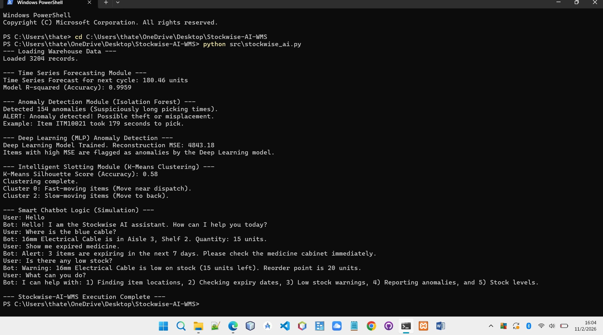
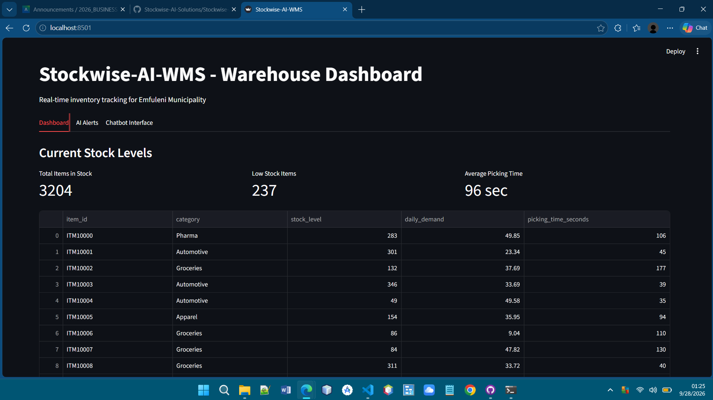
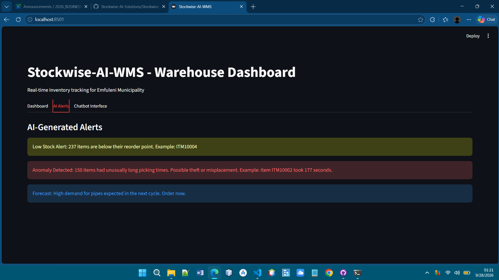
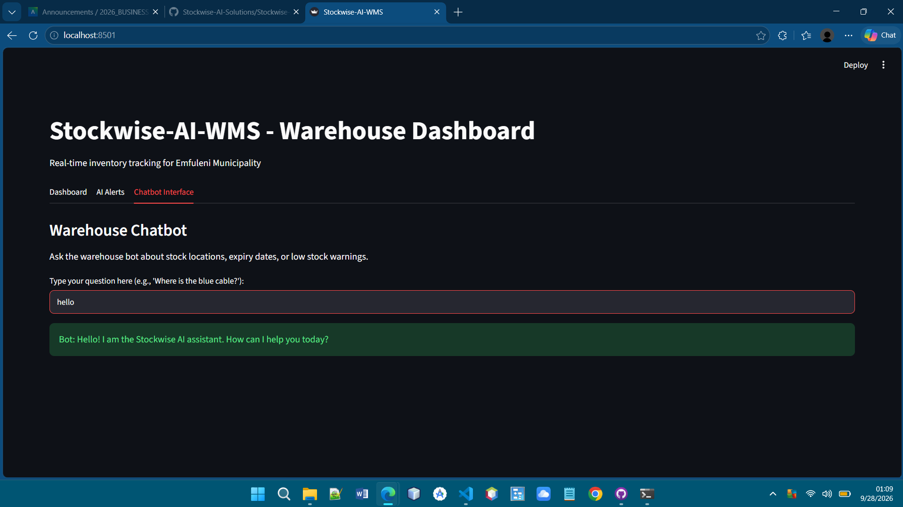
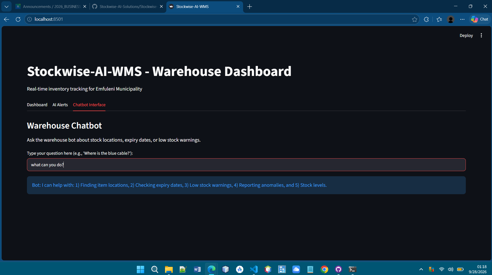
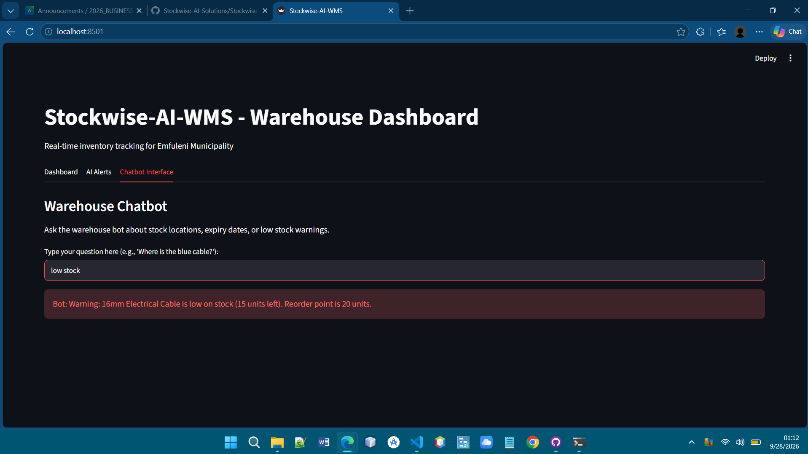

# Stockwise-AI-WMS

**Module:** Business Analysis 3.2 Capstone (AI Solution for Industries)

**Project:** Intelligent Warehouse Management System for Emfuleni Municipality

### Group Members:
- 224376845 - T.A. Lebidike
- 225118157 - N.E. Tsotetsi
- 225089122 - A. Makamole
- 225139987 - G.G. Toyana
- 223268585 - N. Sikhosana

---

## What is this project?
We built Stockwise-AI-WMS for our Business Analysis 3.2 project. The theme was "AI Solution for Industries," and we chose to focus on warehouses. 

During a site visit to a municipal warehouse in Vereeniging, we saw that staff were still using paper logbooks and clipboards to track stock. This makes it hard to know what is in the warehouse, leads to theft, and causes long delays. Our system uses machine learning to solve these problems. It predicts what stock is needed, spots suspicious activity, organises the warehouse layout, and answers staff questions through a chatbot.

## 1. BUSINESS OBJECTIVES
The main objective of Stockwise AI is to develop an affordable, AI-powered Warehouse Management System [WMS] that automates inventory control, optimizes warehouse space, and predicts future stock needs.

Specific Objectives:
- To reduce inventory holding costs by 35% within 12 months.
- To achieve 99.9% inventory accuracy through automation.
- To reduce time taken to find and dispatch an item from 2 hours to under 5 minutes.
- To provide a corruption-proof, transparent reporting system for municipal audit.

## 2. BUSINESS SUCCESS CRITERIA
The project will be considered successful if:
- System adoption by at least 1 municipal warehouse.
- >95% accuracy in stock prediction.
- 50% reduction in expired goods.
- Positive Return on Investment [ROI] within 6 months.

**Community Benefit:** Ensuring 100% stock accuracy, reducing wasteful expenditure by up to 40%, accelerating service delivery [potholes, water leaks, electricity faults fixed faster], improving transparency with automated audit trails, and ensuring clinics never run out of medicine and food parcels are delivered before expiry.

## 3. REQUIREMENTS, CONSTRAINTS & RISKS
**Requirements:**
- Basic internet connectivity
- Android phones / tablets for staff
- Integration with existing municipal financial system

**Constraints:**
- Low digital literacy of warehouse staff
- Poor Wi-Fi coverage in warehouses
- Resistance to change from officials benefiting from the manual system

**Risks & Mitigation:**
- Risk of data privacy: Mitigated by on-premise deployment.
- Risk of inaccurate initial data: Mitigated by a 2-week manual verification phase.
- Risk of power failure: Mitigated by an offline mode that syncs when power returns.

## 4. INITIAL ASSESSMENT OF TOOLS & TECHNIQUES
How AI is applied in our solution:

- **Time-Series Analysis (Demand Forecasting):** We used a Linear Regression model trained on historical stock data to predict future stock needs and forecast demand.
- **Anomaly Detection (Theft Prevention):** We used an Isolation Forest and a Deep Learning Multi-Layer Perceptron (MLP) to detect suspicious picking times. If an item takes unusually long to pick, it is flagged.
- **Intelligent Slotting:** We used K-Means Clustering to group items by popularity and demand, allowing us to place fast-moving items near the dispatch area.
- **Chatbot (NLP):** We built a keyword-based Natural Language Processing bot that answers staff questions about stock levels, locations, and anomalies instantly.

## What does the system do?
1. **Demand Forecasting:** Uses Time Series Analysis (Linear Regression) to predict future stock needs.
2. **Theft Detection:** Uses Isolation Forest and a Deep Learning model (MLP) to find unusual picking times.
3. **Smart Slotting:** Uses K-Means Clustering to group fast-moving items near the dispatch area.
4. **Chatbot:** A simple Natural Language Processing bot that answers staff questions about stock.

## Screenshots of the System

### Terminal Output

*Figure 1: The Python script running in the terminal. It shows the demand forecast, anomaly detection and clustering results.*

### Dashboard Interface

*Figure 2: The main dashboard of our system. It gives an overview of the current stock levels and key warehouse metrics.*

### AI Alerts

*Figure 3: The AI alerts tab, it warns us about low stock items and unusual activity.*

### Chatbot Interface (Greeting)

*Figure 4: The chatbot responding to a simple greeting from a staff member.*

### Chatbot Interface (Features)

*Figure 5: The chatbot explaining the different things it can help with.*

### Chatbot Interface (Low Stock)

*Figure 6: The chatbot responding to a staff question about low stock items.*

### Chatbot Interface (Theft Detection)

*Figure 7: The chatbot giving an alert about recent anomalies and possible theft detected by the system.*
